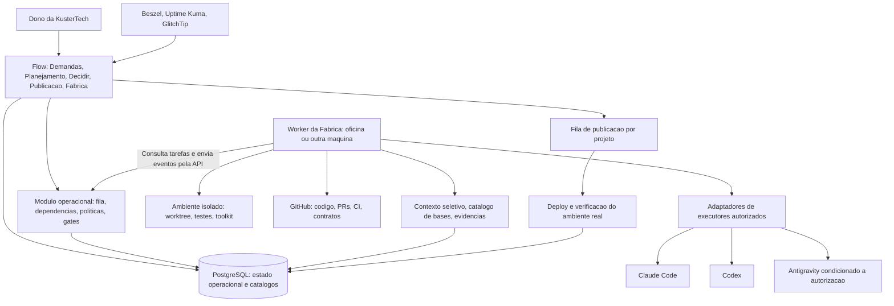

# KusterTech — Fábrica de Agentes 2.0

**Documento de arquitetura, produto e migração**  
**Versão:** 1.0 — 27/11/2026  
**Status:** 10 decisões de direção aprovadas pelo dono; desenho técnico proposto para implementação e validação.

## 1. Mandato do produto

A Fábrica deve ser o ambiente preferencial de planejamento e desenvolvimento da KusterTech. O dono pede, decide produto, escopo, custo e risco e acompanha o resultado. A Fábrica pesquisa o contexto, propõe soluções, reaproveita bases, implementa, testa, publica e confirma o funcionamento. O dono não precisa programar, escolher agentes nem resolver travas mecânicas.

**Pronto = no ar, na versão esperada e funcionalmente conferido.** Um merge, um teste simulado ou um deploy iniciado não constitui entrega. A demanda permanece aberta até a entrega total; impedimentos e entregas intermediárias ficam visíveis, sem serem apresentados como conclusão.

### 1.1 Base factual e causas que justificam o redesenho

Fonte primária: `fabrica-estado-atual-2026-11-27.md` (KusterTech Flow + Fábrica de agentes — estado atual), especialmente seções 9–16. Não houve inspeção do repositório ou execução de provas de conceito nesta etapa.

| Evidência histórica | Causa / interpretação documentada | Resposta do desenho |
|---|---|---|
| 74% do custo equivalente de 32 runs (US$ 29,79) atribuído ao orquestrador; 6 de 9 acordadas sem ação necessária | Espera de merge, timeout, decisões mecânicas delegadas a LLM | Motor determinístico; execução termina sem esperar merge |
| 400 mil a 1 milhão de tokens de cache lidos numa raia típica | Releitura de contexto e fragmentação | Sessões retomáveis, contexto seletivo, etapas funcionais |
| 14 de 27 demandas no ar (52%) | Fluxo e qualidade insuficientes; amostra mensal não é coorte finalizada | Definição de pronto, validação ponta a ponta e acompanhamento por coorte |
| 8 falhas em 11 testes de navegador | Jornada integrada só validada no fim | Testes progressivos, QA independente antes da publicação |
| 35 de 114 seeds com fixer (31%); 64 replanejamentos em 160 raias | Brief/critério, execução ou planejamento imprecisos | Crítica do plano, autocorreção, escalonamento por causa |
| 35 travas em 27 demandas; cerca de 13 associadas à forma do PR de planejamento (avaliação do documento) | Plano sofisticado e controle distribuído | Planos estruturados no Flow; validação de formato por regras |
| Estado em Flow, kit, Warren e Git; conflitos em `.seeds/` | Acoplamento entre controle e código | Flow como autoridade operacional; eliminar Seeds |
| 83 °C, load 11,7, redução de 5 para 3 vagas | Execuções e verificações competem por recursos | Controle de capacidade e workers expansíveis |

As melhorias dos PRs #258, #259 e #261, em produção em 27/11, devem ser preservadas como comportamento: não acordar LLM por espera mecânica, avançar automaticamente, reservar planejamento pesado e criticar planos. Os indicadores acima antecedem ou abrangem essas mudanças; medir novamente antes de atribuir qualquer ganho ao redesenho.

## 2. Decisões aprovadas

| ID | Decisão | Consequência |
|---|---|---|
| F2-01 | Motor híbrido | Coordenação própria; reaproveitar CLIs, Git, isolamento e ferramentas existentes |
| F2-02 | Estado operacional centralizado no Flow | PostgreSQL autoritativo para planos, tarefas, decisões, tentativas e eventos; GitHub autoritativo para código |
| F2-03 | Eliminar Seeds | Demanda → Plano → Etapas → Execuções; preservar histórico legado |
| F2-04 | Etapas funcionais adaptáveis | Uma etapa de implementação por PR (por repositório); autocorreção com continuidade |
| F2-05 | Qualidade contínua proporcional ao risco | Autoverificação, revisão independente, QA integrado e conferência real; aprovação do plano colaborativo antes de execução |
| F2-06 | Planejamento colaborativo com conhecimento permanente | Entrevista, pesquisa, reutilização, crítica e aprovação final explícita |
| F2-07 | Sete papéis principais + especialistas | Separar julgamento e operação; especializar por tarefa |
| F2-08 | Seleção adaptativa de executores | Regras transparentes, evidência de desempenho, sem troca silenciosa, assinaturas autorizadas |
| F2-09 | Infraestrutura híbrida expansível | Começar na oficina; distribuir execução conforme necessidade, sem compra antecipada |
| F2-10 | Metas e melhoria contínua | Medir qualidade, custo, autonomia, velocidade e planejamento |

### 2.1 Invariantes herdados

- D70: Flow conversa com GitHub e Fábrica, respeitadas as exceções aprovadas (D76 site, D81 GlitchTip, D82 Beszel, D83 sistemas conectados). Integrações com modelos acontecem no executor da Fábrica, não diretamente no painel.
- D71: módulos congelados não aparecem nem executam. D72: Início prioriza o que depende do dono. D75: etapas de demanda são configuráveis; o processo possui invariantes de segurança e entrega, não uma sequência fixa para todos os projetos.
- D74: tela nova desenhada e aprovada antes de implementar, conferida no navegador depois. Aprovação prévia delegada no modo autônomo apenas quando expressamente permitido pela política da demanda; exigir decisão humana se não houver delegação.
- D76–D78: confirmar o site real; pronto é no ar; não encerrar com escopo pendente.
- D79: uma demanda pode abranger vários repositórios. D80: núcleo Flow.ia evolui por versão, e forks sobem de versão.
- Merge automático após gates. CI obrigatório somente quando configurado, mas a ausência de CI não dispensa verificação independente em ambiente limpo.
- Preservar contratos externos, revisão cega, merge por SHA, arquivos protegidos, idempotência, trilha, publicação serial por projeto, rollback existente, testes com capturas e pergunta direta com recomendação.
- Flow é público no GitHub: nenhum segredo, dado privado de cliente, estado operacional sensível ou artefato privado no repositório público.
- Sem BMAD; briefs enxutos, entregas verticais. Sem troca silenciosa de modelo, conta ou executor. Não usar API paga sem autorização nem contornar limites de assinaturas.

## 3. Arquitetura-alvo

O desenho representa responsabilidades lógicas, não novos serviços obrigatórios. Começar modularmente no Flow e no kit existente; não introduzir Temporal, um broker, um banco vetorial ou outro orquestrador como pré-requisito. Avaliar componentes extras somente diante de necessidade demonstrada. O worker inicia a comunicação com a API do Flow, preservando a direção atual de integração. Não expor a oficina publicamente nem conceder acesso direto ao banco aos agentes.

### 3.1 Limites entre componentes

| Componente | É responsável por | Não é responsável por |
|---|---|---|
| Flow | Interface, estado autoritativo, planos, decisões, políticas, publicação e indicadores | Rodar comandos de agentes no processo web |
| Módulo operacional | Elegibilidade, dependências, prioridade, reserva de recursos, gates, tentativas, recuperação | Julgar regras de produto por LLM a cada evento |
| Worker | Executar tarefas autorizadas, preparar ambiente, chamar adaptador, coletar logs/evidências, enviar eventos | Inventar tarefas, alterar políticas ou decidir merge fora dos gates |
| Adaptador | Traduzir pedido para CLI suportada, executar, cancelar, informar capacidades, sessão e uso | Ser fonte de verdade do plano ou controlar merge |
| GitHub | Código, branches, commits, PRs, CI, documentação técnica e contratos versionados | Controlar fila, decisões do dono ou estado de execução |
| Conhecimento | Catálogos e contexto versionado por escopo, recuperação seletiva | Compartilhar dados privados entre clientes ou substituir o código como evidência |

### 3.2 Contrato do motor e dos adaptadores (proposta técnica)

A interface `Motor` existente é ponto de partida a inspecionar, não uma obrigação de manter sua forma. Normalizar: iniciar execução com ID idempotente, consultar, transmitir eventos, recuperar/retomar quando suportado, cancelar, coletar resultado e métricas, informar capacidades. Solicitação inclui etapa e versão do plano, modelo/conta autorizados, perfil de permissões, workspace, contexto/toolkit versionados, prazo e orçamento. Resultado distingue sucesso, falha técnica, erro de configuração, limite de uso, cancelamento, saída inválida e estado incerto. Tarefa de leitura pode terminar com sucesso sem commit.

A execução de implementação termina quando entrega o resultado/PR ou falha; não fica presa aguardando review ou merge. Gate, deploy e espera por decisão são estados independentes, sem ocupar slot de agente indevidamente. Uma nova tentativa preserva o PR e reaproveita sessão quando seguro e suportado; se o executor mudar, usa checkpoint resumido e diff, sem prometer continuidade de sessão entre fornecedores.

## 4. Estado, hierarquia e recuperação

### 4.1 Modelo operacional proposto

| Entidade lógica | Informações essenciais |
|---|---|
| Demanda | Projeto(s), intenção, modo, prioridade, critérios de pronto, status, decisão pendente |
| Plano e revisão | Objetivo, escopo, não escopo, riscos, suposições, dependências, critérios, estimativa e revisão aprovada |
| Etapa | Resultado esperado, dependências, repo/área, critérios de aceite, classe de risco, política de verificação |
| Execução/tentativa | Papel, modelo, conta, máquina, sessão, versão do contexto, limites, status e métricas |
| Decisão | Questão, opções, recomendação, resposta, responsável, revisão e data |
| Evidência/gate | Tipo, resultado, commit SHA, ambiente/versão, artefato, verificador e data |
| Publicação | Projeto, commits/versões, ambiente, estado, verificação real e rollback |
| Worker e reserva | Capacidade, heartbeat, tarefas atribuídas, expiração, identificação da geração de execução |
| Evento | Identificador idempotente, entidade, transição, origem, data, correlação |
| Catálogos | Projeto, decisões, bases reutilizáveis, toolkit e perfis/versionamento |

O modelo é conceitual; mapear para as tabelas Prisma existentes antes de criar novas. Não duplicar Demandas, Eventos, Decidir ou publicação que já existam. Arquivos grandes (logs, capturas, relatórios) podem ficar em armazenamento privado com referências e integridade no Flow; escolher solução após inspeção. Credenciais ficam em armazenamento seguro por máquina/conta, não em prompts, logs ou banco de estado sem necessidade.

### 4.2 Estados e recuperação

Demanda: recebida → triada → planejando/desenhando (quando aplicável) → aguardando aprovação (quando aplicável) → pronta para execução → executando → verificando → pronta para publicação → publicando → conferindo no ar → entregue. Bloqueios, pausas, cancelamentos e correções são estados explícitos, não equivalentes à entrega. A sequência pode ser configurada, mantendo os gates obrigatórios.

Etapa de implementação: pendente → elegível → reservada → executando → PR disponível → gates → mergeada. Reprovação retorna para correção; falha persistente pode exigir replanejamento. Etapas de pesquisa, design, QA e publicação podem ter artefatos sem PR. Para múltiplos repos, uma etapa de código tem um repo e PR; agrupar etapas relacionadas no mesmo plano, com contratos e publicação coordenados.

Regras propostas de confiabilidade:

- Reservar tarefa atomicamente com ID/nonce, tentativa, lease e heartbeat. Impedir duas execuções ativas da mesma etapa e colisões de escrita incompatíveis. Aplicar limites por projeto, conta e máquina.
- Registrar intenção antes de chamadas externas, manter eventos idempotentes e caixa de saída durável. Preservar o padrão de nonce existente. Reconciliar com sessões, commits, PRs e deploys antes de repetir ações externas incertas. Não prometer execução exatamente uma vez em sistemas externos sem suporte a idempotência; estado incerto deve ser reconciliado antes de novo disparo pago.
- Se worker cair, recuperar resultado existente ou retomar a sessão; só reatribuir quando execução anterior estiver encerrada/isolada, usando controle de geração para rejeitar resultados obsoletos.
- Se Flow cair, não iniciar novas tarefas nem merges/publicações. Worker pode concluir trabalho já autorizado sob limites locais e persistir eventos para envio posterior; credenciais de produção não ficam com o agente. Eventos atrasados não podem retroceder o estado.
- GitHub, executor e publicação são autoridades sobre fatos externos respectivos. Flow registra e reconcilia esses fatos, sem assumir que ação solicitada foi bem-sucedida.
- Preservar histórico de revisões do plano. Mudar objetivo, critérios de negócio, escopo aprovado, teto de custo ou risco requer nova autorização quando exceder delegação. Ajustes técnicos podem ser aprovados pelo fluxo técnico sem dono.
- Backups testados do banco e artefatos, restauração, migrações compatíveis e alertas operacionais. Definir RPO/RTO após medir requisitos.

## 5. Equipe e independência

| Papel | Missão | Saída | Modelo inicial sugerido |
|---|---|---|---|
| Parceiro de produto | Entrevistar, entender valor, recomendar decisões, organizar requisitos | Resumo, decisões, critérios de negócio | Sonnet; GPT equivalente |
| Planejador | Investigar, reutilizar, propor solução, organizar etapas e riscos | Plano estruturado revisável | Opus; Fable para excepcional complexidade; alternativa avançada autorizada |
| Crítico | Verificar fidelidade às decisões, viabilidade, cobertura e simplicidade | Veredito fundamentado e ajustes | Opus ou alternativa independente |
| Designer | Criar desenho compatível com identidade e componentes existentes | Protótipo e critérios visuais | Sonnet; Gemini autorizado |
| Engenheiro | Implementar, testar, corrigir, abrir PR | Código e evidências | Codex/Sonnet; modelo avançado em escalada |
| Revisor | Revisão cega e independente do código e riscos | Veredito vinculado ao SHA | Codex/Opus conforme risco |
| QA | Validar jornada real, integrações, desktop/mobile | Testes, capturas, defeitos e evidências | Sonnet/Codex; alternativa autorizada |

Especialistas por necessidade: arquitetura, segurança, DevOps, diagnóstico, arbitragem técnica, curadoria de conhecimento. Triagem e extrações simples podem usar modelos econômicos como Haiku, sem criar uma nova equipe permanente. Perfil de especialista inclui missão, ferramentas, limites e permissões. A arbitragem resolve divergências técnicas e filtra perguntas que não são de negócio.

**Quem verifica quem:** crítico verifica o plano do planejador e sua fidelidade ao pedido; dono confirma o plano colaborativo após crítica; revisor verifica o código do engenheiro sem depender da justificativa do executor (usa requisitos confiáveis, diff e evidência); QA verifica a experiência usando critérios de aceite e desenho aprovado; verificações mecânicas são executadas pelo motor em ambiente limpo. Nenhum agente autoriza sozinho seu próprio trabalho. Separar sessões e permissões; preferir outro fornecedor/modelo em tarefas de alto risco quando autorizado e validado. O motor aplica vereditos e condições, não substitui julgamento técnico.

## 6. Planejamento como produto

### 6.1 Modos de entrada

| Modo | O que o dono faz | O que a Fábrica faz |
|---|---|---|
| Planejar comigo | Conversa, toma decisões de negócio, aprova plano final | Investiga, propõe, entrevista, critica e aguarda aprovação explícita |
| Aprovar desenho | Aprova interface e decide exceções de negócio | Planeja e valida tecnicamente, elabora desenho, executa após aprovações necessárias |
| Vai sozinho | Define pedido e delegação; só decide exceções fora dela | Classifica, planeja e valida de forma autônoma dentro da política |

Para planos montados com o dono, inclusive originados fora do Flow e importados, não confundir validação técnica com autorização. Aprovação final obrigatória de uma revisão específica do plano ANTES de enfileirar trabalho de implementação. Sem aprovação, não inicia. Corrigir o plano invalida a aprovação se modificar o conteúdo aprovado materialmente. Pequenas feats e correções automáticas seguem seus modos próprios; não forçar entrevista/aprovação de todo plano automático, mas manter critérios e gates conforme risco.

### 6.2 Conversa de planejamento no Flow

1. Dono descreve objetivo, contexto e expectativa, em português.
2. Parceiro e planejador consultam visão, decisões, código, bases e toolkit permitidos. Identificam lacunas, riscos e possibilidades de reutilização antes de sugerir construir.
3. Uma pergunta por vez, 2–3 opções quando útil, consequências e recomendação. Questões técnicas são investigadas ou arbitradas; questões de produto, escopo, custo e risco ficam com o dono.
4. Elaborar plano com objetivos, entregas, não escopo, jornadas, dependências, repositórios, reutilização, riscos, critérios verificáveis, estratégia de validação/publicação, estimativa e suposições.
5. Validação determinística de estrutura/dependências/permissões; crítico independente confere viabilidade e fidelidade às respostas. Ajustar e validar novamente, com limites de tentativas e orçamento.
6. Mostrar resumo em linguagem de negócio, decisões tomadas, pendências, o que será entregue, não escopo, riscos, estimativa e desenho quando aplicável. Dono pode ajustar, rejeitar ou aprovar versão exata. Não inferir aprovação do silêncio.
7. Após aprovação, registrar revisão, autor e data, criar etapas executáveis, enfileirar e exibir progresso. Mudança material retorna para confirmação.

O plano aprovado é contrato de intenção, não roteiro rígido de cada arquivo. Briefs dos engenheiros devem ser curtos, com links para detalhes sob demanda. Não recriar todo o contexto em cada pergunta; preservar sessão e resumo verificado.

## 7. Conhecimento permanente, projetos base e toolkit

### 7.1 Camadas

- **Empresa:** padrões técnicos, qualidade, segurança, design, processos e ferramentas aprovadas.
- **Biblioteca reutilizável:** bases de sistemas, módulos, componentes, integrações, templates, versões, dependências, compatibilidade e instruções.
- **Projeto:** visão de produto, regras, arquitetura, identidade visual, integrações/contratos, ambientes, decisões, limitações e histórico relevante.
- **Demanda:** pedido, conversa, plano aprovado, decisões, critérios, referências, mudanças, evidências.

Flow é o catálogo e índice operacional do conhecimento. Documentação técnica e código versionados permanecem nos repositórios apropriados. Cada item deve possuir origem, escopo de acesso, versão/commit, data, validade e responsável. Separar fatos confirmados, propostas, hipóteses e conhecimento desatualizado. Não assumir que informação antiga ou documentação divergente representa o estado atual. Indexar e atualizar mediante mudanças confirmadas, sem enviar tudo para todos os agentes. Começar com busca estruturada/textual e links; avaliar recuperação semântica ou grafo apenas se houver necessidade medida.

### 7.2 Ciclo de conhecimento e reutilização

No planejamento: pesquisar soluções existentes → comparar compatibilidade, licença/permissão, manutenção e custo → recomendar reutilizar, adaptar ou construir → registrar referência exata no plano. Na execução: recuperar apenas materiais autorizados e relevantes; revisar contratos com a origem e usar versão conhecida. Na entrega: propor atualização da visão e documentação baseada no que realmente foi entregue; curadoria valida antes de tornar regra reutilizável.

Para Flow.ia e forks: núcleo versionado primeiro (D80), compatibilidade e testes de atualização, registrar versões utilizadas pelos forks. Não propagar mudança automaticamente sem política de atualização e validação. Dados, segredos, regras proprietárias e artefatos de cliente não entram no catálogo compartilhado sem autorização. Projetos de clientes são segregados; bases reutilizáveis precisam ter direito de reutilização confirmado.

### 7.3 Toolkit versionado

| Perfil | Ferramentas iniciais |
|---|---|
| Produto/planejamento | Busca, Superpowers, Archify, Floorplan, catálogo de bases |
| Designer | Kit visual, componentes, Playwright |
| Engenheiro | Superpowers, RTK, Ponytail e ferramentas do stack |
| Revisor/especialista | RTK, Security Audit, análise de código |
| QA | Playwright, testes de integração, coleta de evidências |

Manter manifesto de ferramenta com versão, origem, papéis, permissões, requisitos e instalação verificável. Archify e Floorplan não estão instalados na oficina segundo o documento; testar antes de depender deles. Adaptadores mapeiam ferramentas para recursos realmente suportados por cada executor; não presumir paridade de skills. Não carregar toolkit inteiro se não necessário. Mudanças em ferramentas/políticas passam por testes e revisão, com rollback.

## 8. Da demanda até o ar

1. Recepção, classificação e seleção do modo; demandas duplicadas são conciliadas sem reexecutar.
2. Planejamento conforme risco e modo; investigar reutilização; desenho antes de implementação de tela; validar plano e colher aprovações necessárias.
3. Registrar etapas e dependências; disponibilizar apenas as elegíveis. Reservar capacidade sem colisões incompatíveis de arquivos/contratos.
4. Engenheiro usa workspace isolado, recebe objetivo e contexto seletivo, implementa e verifica. Testa integração progressivamente, corrige dentro de limites e cria PR com evidências.
5. Motor solicita revisão cega e testes independentes no SHA exato do PR. CI conforme política, contratos externos, arquivos protegidos, testes apropriados e vereditos são gates. Divergência de SHA invalida evidências relevantes; executar novamente. Merge automático apenas quando aprovados.
6. Em caso de falha, classificar causa: mecânica → regras; código → executor original; falha repetida → especialista/modelo mais capaz; plano errado → planejador e crítico; negócio/risco/custo fora da autorização → dono. Definir tetos configuráveis e não reiniciar contadores em loop. Não afrouxar critérios para obter aprovação.
7. QA independente valida cada jornada quando possível e a integração completa antes da publicação, com backend real ou ambiente representativo conectado às dependências pertinentes. Simulação sozinha não autoriza publicação. Em demanda multi-repo, verificar compatibilidade de versões, ordem de rollout e rollback; não publicar integração incompleta.
8. Fila serial de publicação por projeto, respeitando versões já no ar e os impedimentos existentes. Publicação de etapa só se for segura e independente (sem expor fluxo incompleto); demanda não é concluída parcialmente. Utilizar flags quando justificadas e aprovadas pela política, não como desculpa para adiar escopo.
9. Conferir SHA/versão no ambiente real e validar jornada com ações seguras, sem gerar transações indevidas ou usar dados pessoais desnecessários. Falha → manter demanda aberta, reparar ou reverter conforme política e repetir verificação.
10. Entregar: apresentar resultado, evidências, versão, consumo e eventual informação relevante. Atualizar conhecimento confirmado e métricas.

### 8.1 Matriz de verificação

| Tipo de alteração | Verificação adicional típica |
|---|---|
| Texto e ajustes pequenos | Revisão e verificação direcionada |
| Interface | Desenho aprovado, comparação visual, interação desktop/mobile |
| Regra de negócio | Testes unitários e de integração com casos críticos |
| Funcionalidade | Jornada de ponta a ponta e regressões afetadas |
| Integração | Contrato com origem e dependência real em ambiente seguro |
| Segurança | Especialista, casos de acesso indevido, análise e evidências |
| Infra | Saúde, compatibilidade, limites e recuperação/rollback |

Todas respeitam os gates obrigatórios. Preservar arquivos protegidos e exigir autorização apropriada para alterações sensíveis. Ambiente de autoverificação do agente e ambiente independente de gate são distintos. Agente de leitura não possui permissão de escrita/merge. Agentes não recebem credenciais de deploy ou Docker socket irrestrito. Disponibilizar testes por mecanismos controlados e limitar rede, CPU, memória, disco e acesso a segredos.

## 9. Estratégia de inteligência e custo

Iniciar com matriz de papel × tipo de tarefa × risco × complexidade × disponibilidade. Níveis: econômico (triagem/extração), profissional (engenharia/conversa/QA), avançado (planejamento e revisões críticas), excepcional (problemas difíceis). Política determinística escolhe entre candidatos autorizados; o histórico pode recomendar atualização da matriz. Não chamar um LLM apenas para decidir qual LLM usar. Medir qualidade antes de privilegiar custo nominal.

Registrar executor, versão do modelo, conta, esforço, ferramentas, motivo da seleção e mudança, tempo, tokens disponíveis, cache, cotas e tentativas. Trocas previstas em política são registradas e visíveis; alteração de política/conta sem autorização não é permitida. Preservar capacidade para planejamento e urgências. Limites de assinatura levam a espera ou alternativa autorizada, nunca a contorno de restrições. Não presumir que custo equivalente em API é dinheiro gasto. Reportar mensalidades/infra e cobrança real separadamente de consumo de tokens/cotas e estimativa comparável. Campos ausentes ficam como indisponíveis, não zero.

Claude Code, Codex e Antigravity são candidatos, não integrações comprovadas. Verificar condições atuais de automação, assinatura, conta reserva, modo leitura, autenticação, cancelamento, seleção de modelo e telemetria antes de habilitar cada um. Se uma modalidade não for autorizada, mantê-la desabilitada. A decisão híbrida continua válida com um único adaptador inicialmente, sem depender de integração de todos para migrar.

## 10. Infraestrutura e segurança

Começar na oficina atual (Debian 13, 4 núcleos, cerca de 7 GB RAM relatados). Reservar capacidade para Flow/Postgres e conversas. Não adotar a quantidade atual de vagas como limite seguro sem medir. Scheduler admite tarefas pela necessidade de CPU, RAM, disco e prioridade; heartbeat reporta capacidade e saúde. Limitar concorrência de testes/builds pesados, impor timeouts e pausar admissão em pressão de recursos/temperatura. Os valores finais dependem de teste de carga.

Workers autenticados por credenciais restritas, preferencialmente na rede privada Tailscale. Worktrees isolam alterações Git, mas não são sandbox de segurança; combinar com processos/contêineres de permissões restritas. Caches de dependências/build por versão e lockfile, sem segredos e sem contaminação entre clientes. Gate independente parte de código e dependências verificáveis. Ambientes temporários têm limpeza e retenção definidas. Monitorar Beszel, Uptime Kuma, GlitchTip e capacidade do worker; evitar depender de um Mac ligado para sincronizar estado.

A expansão futura consiste em registrar nova máquina, instalar executor/toolkit e configurar escopos. Sem acesso direto ao Postgres por workers; API autenticada. Se a oficina continuar saturada ou disponibilidade do Flow for insuficiente, considerar VPS/segunda máquina e separar controle de execução. Não contratar nesta fase. A centralização cria dependência do Flow; preparar backup/restauração e modo de reconciliação antes de distribuir workers.

## 11. Indicadores, metas e melhoria contínua

Metas aprovadas para a operação estabilizada, não promessas nem limiares automáticos de implantação. Baseline histórico do documento; reavaliar após as mudanças de 27/11. Comparar coortes com complexidade/risco semelhantes e janela de observação definida, publicando tamanho de amostra e pendências. Separar cancelamentos justificados e demandas que não exigem código/deploy, sem esconder falhas.

| Indicador | Referência histórica | Meta aprovada | Como medir na 2.0 |
|---|---|---|---|
| Demandas no ar | 14/27 no período (52%) | ≥95% | Demandas elegíveis entregues e verificadas / demandas da coorte com janela de observação definida; mostrar abertas e canceladas separadamente |
| Aprovação de navegador de primeira | 3/11 (27%) | ≥90% | Primeira verificação independente de jornada aprovada / jornadas verificadas; distinguir autocorreção anterior do executor |
| Aprovação de etapa sem correção externa | 79/114 seeds sem fixer (69%) | ≥90% | Etapas que passam gate independente sem retorno para correção / etapas verificadas; comparabilidade limitada pela nova unidade |
| Consumo equivalente por demanda comparável | Medir baseline pós-27/11 | Redução de 50% | Comparar custo equivalente padronizado de todas as tentativas, planejamento e QA, por demanda entregue e classe de complexidade; divulgar tokens/cotas separados |
| Intervenções técnicas do dono | 35 travas totais (não equivale a 35 intervenções humanas) | Zero como objetivo | Contar pedidos de ação mecânica/técnica ao dono; distinguir aprovações e decisões legítimas de negócio |
| Velocidade | Baseline a medir | Melhorar sem sacrificar gates | Tempo do pedido à conferência no ar; separar tempo ativo, espera por decisão e fila |
| Planejamento | Baseline a medir | Melhorar fidelidade e reduzir retrabalho | Alterações materiais após aprovação, falhas de escopo, crítica de primeira, satisfação do dono |
| Regressões e incidentes | Baseline a medir | Não aumentar; reduzir | Falhas após publicação, rollback, gravidade e tempo de recuperação |
| Reutilização e toolkit | Baseline a medir | Aumentar quando vantajoso | Reutilizações comprovadas, origem/versão, esforço evitado estimado e incidência de regressões |

Não comparar diretamente taxa por seed com taxa por etapa sem explicitar a mudança de granularidade. Para custo, manter registro de metodologia/tabela de preços de referência, normalizar cache quando possível, informar cobertura de telemetria e não misturar estimativa com cobrança. Incluir também trabalho desperdiçado de demandas não entregues no numerador agregado por coorte, para não premiar falhas ocultadas.

### 11.1 Painel e relatório

Flow apresenta primeiro decisões do dono; depois entregas, pendências, evolução semanal e principais gargalos. Mostrar custo real mensal, consumo de cota, custo equivalente por entrega, aprovações de primeira, falhas, prazo, capacidade e comparativo de modelos por tarefa. Um resumo curto explica o que melhorou/piorou e recomenda uma ação com evidência. Métricas detalhadas e logs ficam acessíveis para auditoria, não como obrigação de uso do dono.

### 11.2 Aprendizado controlado

Registrar causa de falhas, propor mudança em prompts, ferramenta, padrão, teste, roteamento ou motor, experimentar com escopo controlado, validar antes/depois e registrar versão. Alterações na Fábrica seguem revisão independente e testes; não pode alterar seus próprios controles para aprovar resultados, ampliar privilégios ou aumentar teto financeiro sem a autorização adequada. O aprendizado não significa treinar modelos automaticamente com dados de clientes. Não transformar toda falha em nova regra: curadoria identifica recorrência e impacto.

## 12. Migração incremental sem parar a Fábrica atual

Princípio: uma demanda tem um único motor responsável por execução e publicação em cada momento. Coexistência não significa executar a mesma demanda nos dois sistemas. Preservar entregas em andamento no legado; não converter planos ativos por padrão. Operação e schema devem ser compatíveis enquanto os dois caminhos coexistem.

| Fase | Entregas | Critério de saída | Retorno seguro |
|---|---|---|---|
| M0 — Inventário e baseline | Mapear código, tabelas, APIs, estados, testes, skills, contratos, permissões e custos; identificar pontos dependentes do Warren; verificar termos dos executores e capacidade da oficina | Inventário aprovado tecnicamente, baseline documentado, backup/restauração testados | Sem alteração de execução |
| M1 — Fundação | Módulo operacional no Flow; planos/versionamento, etapas, tentativas, eventos idempotentes, reservas e API de worker; painel em modo observação; migrações aditivas | Testes de transições, duplicidade, concorrência, retomada e indisponibilidade; legado continua funcionando | Desabilitar caminho novo, preservar dados |
| M2 — Motor e adaptador inicial | Prova de execução real com uma CLI autorizada; leitura e escrita separadas, worktree/isolamento, logs, métricas, limites, cancelamento, retomada e gates reaproveitados | Exercícios controlados de sucesso, falha, reinício, limite de cota, cancelamento e resultado incerto; nenhum merge fora dos gates | Desabilitar adaptador e continuar legado |
| M3 — Piloto ponta a ponta | Demandas novas de baixo risco em projeto selecionado; etapas adaptáveis sem Seeds, autoverificação, revisão, QA e deploy real; monitorar desempenho | Evidências no SHA, confirmação da versão real, recuperação e rollback demonstrados; nenhuma regressão crítica, sem duplicar publicação | Parar admissão nova; reconciliar PRs/deploys; redirecionar somente demandas elegíveis |
| M4 — Planejamento e conhecimento | Conversa no Flow, modos, crítico, aprovação de versão, visão do projeto, catálogo de bases e toolkit inicial | Plano colaborativo bloqueado até aprovação, alteração relevante exige reconfirmação, reutilização rastreável, isolamento de clientes validado | Manter planejamento legado para novas demandas elegíveis, preservar planos e aprovações |
| M5 — Expansão e roteamento | Mais adaptadores autorizados, especialistas, seleção por regras, métricas por modelo, múltiplos workers quando justificado; incluir integrações multi-repo | Testes de indisponibilidade, cotas e troca registrada; integração multi-repo e capacidade validadas; desempenho comparável sem piora crítica | Desabilitar adaptador/worker, manter executor comprovado |
| M6 — Corte progressivo | Novo motor passa a padrão para projetos elegíveis; drenar Warren; exportar histórico, logs/custos permitidos e referências Seeds; remover contornos só após estabilização | Critérios de aposentadoria cumpridos, nenhum plano legado ativo, histórico consultável, restauração/rollback validados | Reativar caminho legado somente com compatibilidade e reconciliação, nunca em paralelo para a mesma demanda |

Durante M1–M6, marcar cada demanda com motor responsável; usar flags de ativação por projeto/tipo de demanda, identificadores estáveis e publicação com deduplicação compartilhada. Mesmo com dois motores, preservar exclusão de alterações conflitantes no mesmo repositório e fila serial de publicação por projeto; se exclusão cruzada não for implementada com segurança, pilotar em repo segregado ou janela sem trabalho legado concorrente. O painel distingue estado autoritativo novo de retratos históricos/legados. Não importar segredos ou dados privados para o repo público. Importar histórico Seeds com origem e IDs, sem reativá-lo como fila.

### 12.1 Critérios para aposentar o Warren

- Todos os tipos de fluxo atualmente necessários foram demonstrados no novo motor: planejamento colaborativo, demandas automáticas, tela, correção, integração, publicação e recuperação.
- Revisor independente, verificação em ambiente limpo, merge pelo SHA, contratos, arquivos protegidos e conferência real não foram enfraquecidos.
- Provas de reinício, duplicidade, perda de comunicação, tentativa incerta, cancelamento e falha de deploy aprovadas; sem dupla execução ou publicação.
- Piloto com coortes comparáveis demonstra desempenho pelo menos equivalente à referência atualizada, sem aumento de incidentes críticos ou custo não autorizado. Metas de F2-10 orientam evolução, e não autorizam ignorar critérios de segurança.
- Nenhum plano legado ativo, histórico preservado, rollback operacional documentado e aprovado. A duração e o tamanho mínimo do piloto serão definidos após M0, por representatividade e risco; não inventar prazo fixo a partir de 27 demandas.

## 13. Critérios de aceite do produto 2.0

| ID | Cenário observável | Resultado esperado |
|---|---|---|
| AC01 | Dono pede para planejar um produto no Flow | Entrevista em português, recomendações, investigação e plano consolidado |
| AC02 | Plano colaborativo não aprovado ou alterado materialmente | Nenhuma implementação enfileirada até aprovação da revisão aplicável |
| AC03 | Solicitação de ajuste autônomo de baixo risco | Executa sem entrevista desnecessária, respeitando gates e delegação |
| AC04 | Tela nova | Desenho aprovado antes, verificação de desktop e celular depois |
| AC05 | Solução reutilizável encontrada | Origem, versão, compatibilidade e decisão de reutilização registradas |
| AC06 | Etapas independentes e dependentes | Paralelismo seguro; dependências reais impedem avanço prematuro |
| AC07 | Executor termina e PR aguarda gates | Vaga liberada; nenhum LLM acionado por simples espera |
| AC08 | Agente revisor apenas lê | Sucesso sem commit; não pode escrever/mergear |
| AC09 | Testes falham ou SHA muda | Bloqueio, correção e revalidação apropriada; nenhum merge sem gate |
| AC10 | Backend simulado passa, real falha | Publicação/conclusão bloqueada até prova real pertinente |
| AC11 | Falha mecânica, reinício, evento duplicado | Reconciliação sem duplicar trabalho/efeito externo; estado incerto visível |
| AC12 | Limite de cota ou troca de executor | Motivo registrado; somente alternativa autorizada; sem cobrança inesperada |
| AC13 | Demanda envolve dois repos | Contratos e versões compatíveis, publicação coordenada, entrega integral |
| AC14 | Deploy falha ou versão incorreta está no ar | Demanda aberta; reparo/rollback e nova conferência |
| AC15 | Flow indisponível/worker cai | Sem nova admissão ou ação irreversível indevida; recuperação consistente |
| AC16 | Agente tenta acessar cliente não autorizado | Acesso negado; segredo/dado não exposto ao repo público nem aos logs |
| AC17 | Oficina sob pressão de recursos | Admissão limitada, prioridade de interação do dono preservada |
| AC18 | Novo motor convive com Warren | Sem dupla propriedade de demanda, conflitos cruzados ou dupla publicação |
| AC19 | Dono abre Início e desempenho | Pendências de negócio primeiro; qualidade, custo, autonomia e recomendações auditáveis |
| AC20 | Fábrica propõe melhoria própria | Mudança versionada, revisada, testada e sem relaxar política ou ampliar gasto sem autorização |

## 14. Pendências técnicas e escolhas não aprovadas explicitamente

As decisões F2-01 a F2-10 estão aprovadas. Este documento propõe detalhes necessários para torná-las implementáveis; não certifica que o código já oferece os recursos abaixo. A equipe técnica deve investigá-los e resolver o que estiver dentro da delegação, chamando o dono apenas se mudar produto, escopo, custo ou risco.

- Inspecionar o contrato `Motor`, coordenador, despachante, tabelas Prisma, publicação e os 2.489 testes relatados; separar código de domínio dos contornos do Warren. Não estimar quantas linhas serão removidas antes disso.
- Validar uso autorizado de assinatura e conta reserva, headless, telemetria, modo leitura, cancelamento, retomada e seleção de modelo em cada CLI. As alternativas por papel são configurações iniciais propostas, não benchmark. Antigravity e rotação de contas permanecem condicionados à autorização; não contornar limites.
- Escolher mecanismo de isolamento, cache, retenção de artefatos, credenciais, leases, política de orçamento/timeout/tentativas e limites térmicos com provas reais. O Mermaid é mapa lógico, não especificação de serviços ou schema.
- Definir coortes, janela de observação e metodologia comparável para métricas; coletar baseline pós-27/11. Não há prazo ou custo de implementação aprovado. Estimar após inventário.
- Definir projeto piloto de baixo risco, estratégia de colisão com legado, validação de contratos e ambientes reais, além de RPO/RTO e procedimentos de restauração. Não usar produção de clientes como ambiente de experimentos.
- Validar catálogo e direitos de reutilização de bases, escopos por cliente, fontes de conhecimento, instalação de Archify/Floorplan e compatibilidade do toolkit entre executores. Grafo, busca vetorial e fila externa não são pré-requisitos.
- A centralização no Flow introduz dependência operacional; decidir eventual separação física após teste de capacidade e disponibilidade. Nenhuma compra aprovada nesta etapa.

## 15. Próxima ação recomendada

Iniciar M0, sem reescrever a Fábrica e sem desativar Warren. Entregar um inventário rastreável, mapa de reaproveitamento do kit e do Flow, baseline atualizado, prova de viabilidade dos adaptadores e plano de implementação com riscos, critérios de aceite e sequência de migração. Submeter o plano consolidado ao dono antes de iniciar a construção, de acordo com F2-05/F2-06. Depois executar progressivamente e demonstrar cada critério de saída.

### Referência de rastreabilidade

Documento de estado atual, 27/11/2026: §1 objetivo e preferências; §2 infraestrutura; §§3–5 arquitetura e fluxos; §§6–8 agentes, orquestração e gates; §9 estado; §§10–11 números e problemas; §12 preservação; §13 mudanças em produção; §14 decisões herdadas; §15 perguntas de redesenho; §16 dimensão do kit. As decisões F2-01 a F2-10 provêm da conversa de aprovação subsequente. O restante está identificado como desenho/proposta ou critério operacional recomendado, sujeito a validação técnica.
